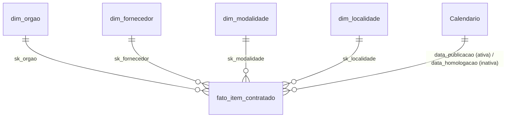
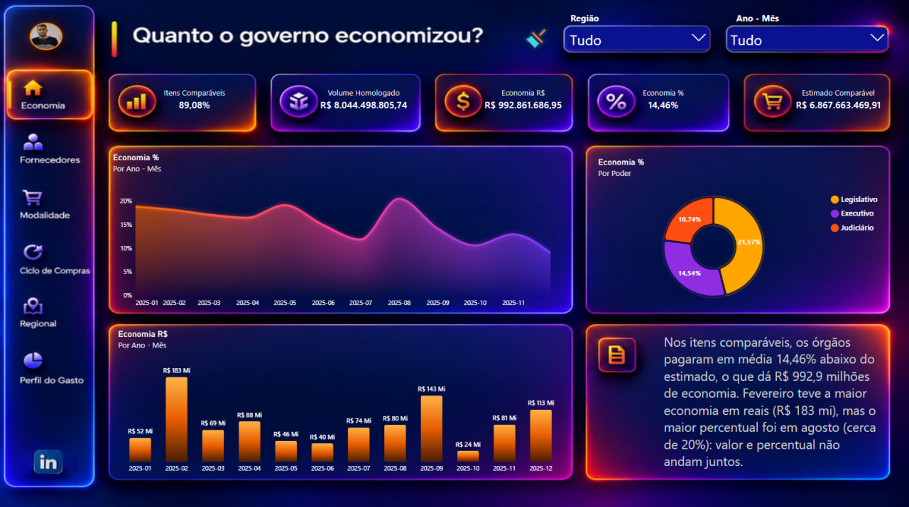
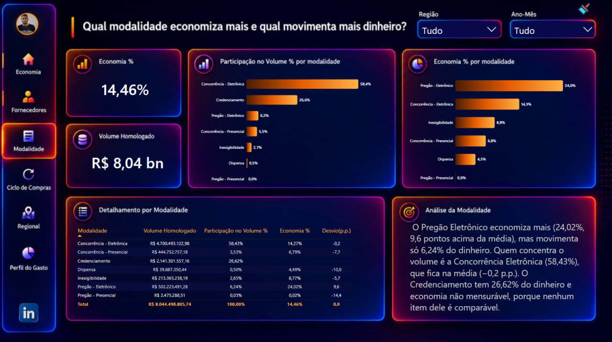
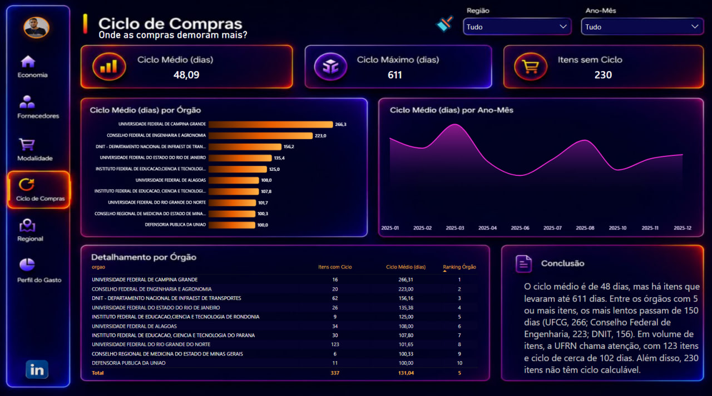
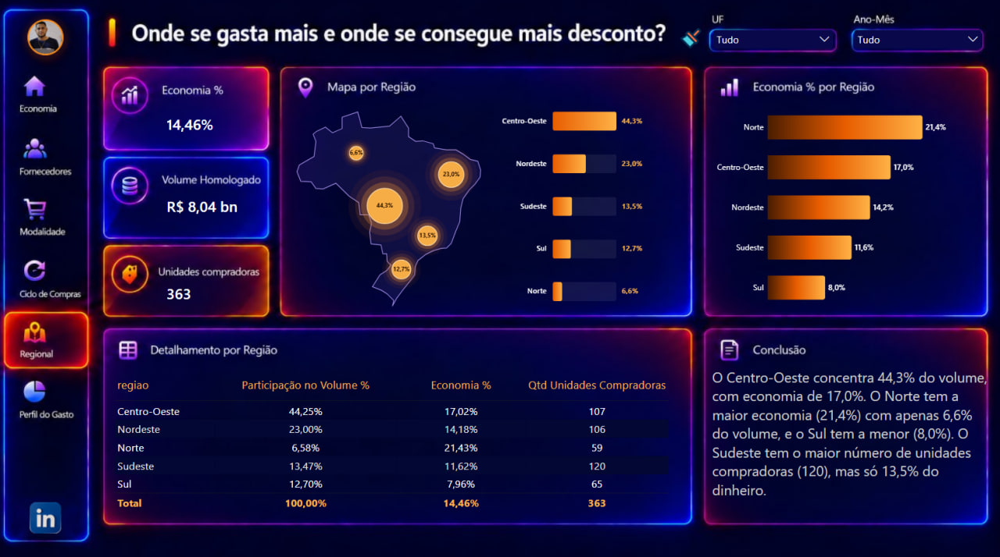
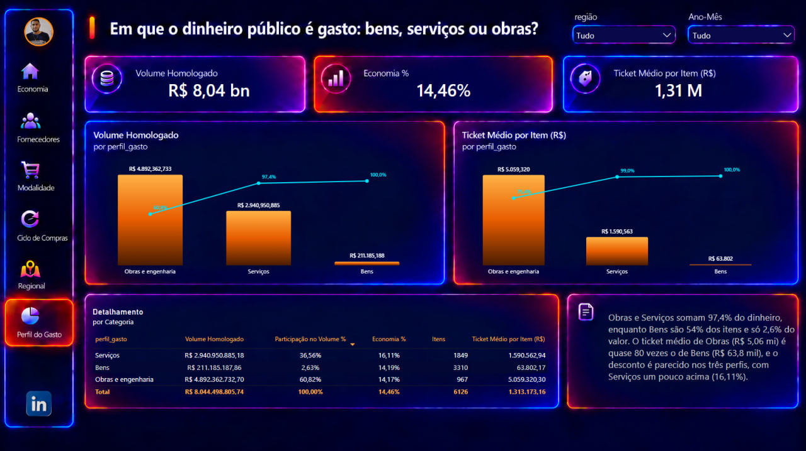
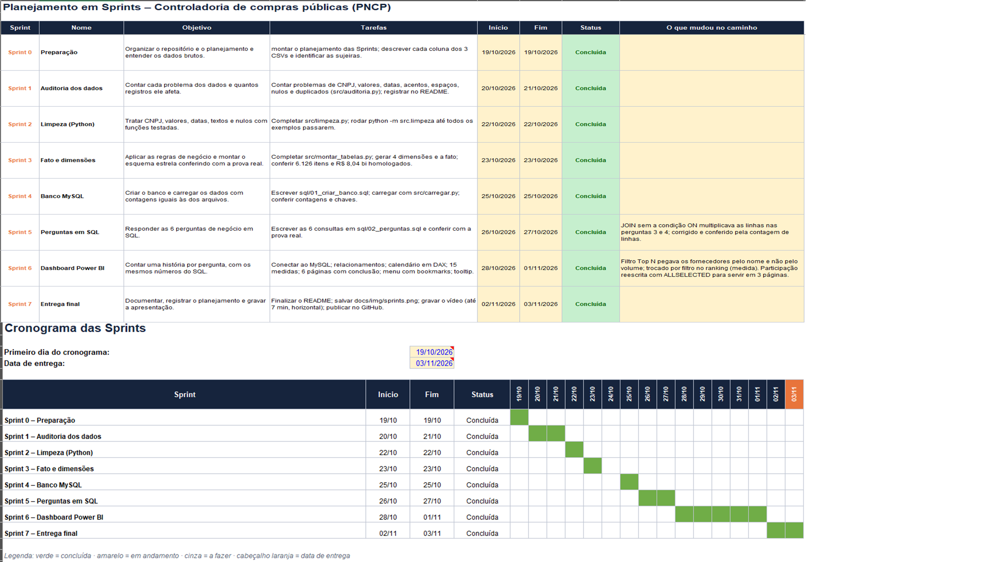

# Controladoria de compras públicas (PNCP)

Pipeline completo: dados brutos (CSV) → limpeza em Python → banco MySQL (modelo estrela) → seis perguntas de negócio em SQL → dashboard em Power BI.
Projeto final do módulo 2 – Gestão de Dados com Arquitetura Moderna (SENAI/SC).

**Autor:** Lucas Mendes
**Painel online:** [Abrir o dashboard no navegador](https://app.powerbi.com/view?r=eyJrIjoiMzY3MTRmYmEtZTZmNy00MDUyLWJhYmUtYmFjOTM1N2JiMTI2IiwidCI6ImJkYmZhYWY1LTE1MjctNDdhOC05NzM0LTQyMDVmNDQ4YTRmZSJ9)

**Vídeo de apresentação (até 7 min):** [https://drive.google.com/file/d/13eCCS8qpweOTrSd5IdJu80Z_BDV2mzqX/view?usp=sharing]

## Resultado em números

| Indicador | Valor |
|---|---|
| Itens na tabela fato | 6.126 (de 7.077 itens brutos) |
| Contratações / órgãos (CNPJ) / fornecedores | 1.962 / 363 / 2.652 |
| Volume homologado | R$ 8.044.498.805,74 |
| Economia (itens comparáveis) | R$ 992.861.686,95, ou 14,46% do estimado |
| Itens comparáveis | 5.457 (89,08%) |
| Ciclo médio / máximo | 48,1 / 611 dias (230 itens sem ciclo) |

## Estrutura do repositório

```
├── data/raw/          CSVs brutos (compras, itens, resultados)
├── data/processed/    tabelas limpas geradas pelo pipeline (dimensões e fato)
├── src/               limpeza.py, montar_tabelas.py, carregar.py, banco.py, config.py, auditoria.py
├── sql/               01_criar_banco.sql, 02_perguntas.sql
├── powerbi/           dashboard (.pbix)
├── docs/              enunciado e figuras (docs/img/sprints.png)
├── env.example        modelo das variáveis de conexão (o .env real não é versionado)
└── requirements.txt
```

## Como reproduzir

Pré-requisitos: Python 3.10+, MySQL 8, MySQL Workbench, Power BI Desktop e o **MySQL Connector/NET 8.x** (necessário para o Power BI se conectar ao MySQL).

1. Instale as dependências: `pip install -r requirements.txt`
2. Copie `env.example` para `.env` e preencha usuário e senha do seu MySQL.
3. Teste as funções de limpeza: `python -m src.limpeza` (todos os exemplos devem passar).
4. (Opcional) Conte os problemas dos dados brutos: `python -m src.auditoria`
5. Gere as tabelas limpas: `python -m src.montar_tabelas` (imprime a conferência com os totais esperados).
6. No Workbench, execute `sql/01_criar_banco.sql` para criar o banco e as tabelas.
7. Carregue os dados: `python -m src.carregar` (conta as linhas e confere com os arquivos).
8. Execute `sql/02_perguntas.sql` para ver as respostas das seis perguntas.
9. No Power BI Desktop, abra `powerbi/` (.pbix). Se pedir, atualize a fonte: *Obter dados > Banco de dados MySQL*, servidor `localhost:3306`, banco `pncp_controladoria`, autenticação básica.

## Auditoria dos dados brutos

Contagens feitas com `python -m src.auditoria` sobre os arquivos originais (2.042 compras, 7.077 itens, 15.896 resultados).

| Problema | Onde | Registros afetados | Tratamento |
|---|---|---|---|
| CNPJ do órgão com máscara | compras.cnpj_orgao | 176 | manter só dígitos |
| CNPJ do órgão sem zero à esquerda (<14 dígitos) | compras.cnpj_orgao | 77 | completar com zeros até 14 |
| CNPJ/CPF do fornecedor com máscara | resultados.ni_fornecedor | 1.633 | manter só dígitos, tamanho conforme `tipo_pessoa` (PJ 14, PF 11, PE inalterado) |
| Dinheiro em texto com "R$" | itens (quantidade 1.148, valor unitário estimado 1.188); resultados (valor unitário homologado 2.650, quantidade homologada 2.561) | 7.547 células | converter para número |
| Vírgula como decimal | itens (1.481 e 1.602); resultados (3.614 e 3.424) | 10.121 células | regra da base: ponto ou vírgula sozinho é decimal; só o símbolo repetido é milhar |
| Datas em 6 formatos | compras.data_publicacao: 1.319 ISO com hora, 243 DD/MM/AAAA, 138 DD-MM-AAAA, 120 DD.MM.AAAA, 116 AAAA/MM/DD, 106 AAAAMMDD | 2.042 | converter para data (sem hora), aceitando só anos de 2000 a 2030 |
| Datas em 6 formatos | resultados.data_resultado: 10.301 AAAA-MM-DD, 1.863 DD/MM/AAAA, 912 DD-MM-AAAA, 937 DD.MM.AAAA, 960 AAAA/MM/DD, 923 AAAAMMDD | 15.896 | idem |
| Acento quebrado (UTF-8 lido como Latin-1) | objeto_compra 173, descrição do item 223, nome do fornecedor 4 | 400 | `consertar_acento` |
| Espaços sobrando ou repetidos | nome do órgão 58, objeto 519, descrição 606, nome do fornecedor 501 | 1.684 | `tirar_espacos` |
| Caractere invisível | objeto_compra | 1 | removido |
| Nome do órgão escrito de formas diferentes | 440 nomes distintos | 88 variantes a menos | padronizado para maiúsculas (352 nomes); ranking agrupa pelo nome |
| Nome do fornecedor escrito de formas diferentes | 10.707 nomes distintos | 542 variantes a menos | padronizado (10.165 nomes) |
| Nulos disfarçados ("0", "Não se aplica", vazio) | em colunas não usadas na fato: processo 77, modo_disputa 967, datas de proposta 617, categoria_item 7.077, catálogo 7.068, critério de julgamento 1.883, porte 4.893 | — | tratados como nulo em `limpar_texto` |
| Resultados cancelados | resultados.data_cancelamento preenchida | 62 | removidos |
| Vários resultados por item | resultados ativos: 15.834 | 9.609 não vencedores | fica o de menor `ordem_classificacao_srp`, com desempate pelo sequencial |
| Itens sem resultado válido | itens | 852 | ficam fora da fato |
| Orçamento sigiloso | itens | 54 | rejeitados |
| Itens rejeitados pelas regras de valor | itens com resultado: 6.225 | 99 | quantidade ou valor ausente/≤ 0, sigiloso, estimado < R$ 1, homologado > 1.000× o estimado, valores > R$ 1 trilhão |
| Homologação anterior à publicação | itens da fato | 230 | data de homologação vazia, item permanece, ciclo vazio |

Fluxo do funil: 7.077 itens → 6.225 com resultado → **6.126** na fato (99 rejeitados).

## Decisões técnicas

- **Leitura tudo como texto** (`dtype=str`): evita perder o zero à esquerda do CNPJ e que um "N/A" vire número ou nulo sem aviso.
- **Modalidade pelo `modalidade_id`**: o nome vem de um dicionário, e não do texto do arquivo.
- **Região** montada a partir da `uf_sigla` (o arquivo não traz a região).
- **Perfil do gasto:** `material_ou_servico` decide Bens ou Serviços, e as palavras inteiras *obra, construção, reforma, engenharia* (com `\b` na expressão regular) definem "Obras e engenharia", que tem prioridade.
- **Economia só onde dá para comparar:** o item é comparável se não for Credenciamento (modalidade 12) e a razão homologado/estimado estiver entre 0,1 e 10. A economia % é soma da economia ÷ soma do estimado comparável (nunca média de percentuais).
- **Chaves substitutas (`sk_`)** nas dimensões, para isolar o modelo das chaves naturais (CNPJ, sigla).
- **Fornecedor = CNPJ/CPF limpo:** o mesmo nome com CNPJ diferente (filiais) conta como fornecedor diferente.

## Modelo de dados (esquema estrela)



| Tabela | Linhas | Chave natural |
|---|---|---|
| dim_orgao | 363 | cnpj_orgao |
| dim_fornecedor | 2.652 | ni_fornecedor |
| dim_modalidade | 7 | modalidade_id |
| dim_localidade | 27 | uf_sigla |
| fato_item_contratado | 6.126 | numero_controle_pncp + numero_item |

## Perguntas de negócio e respostas

Cada resposta existe em SQL (`sql/02_perguntas.sql`) e no dashboard, com os mesmos números.

1. **Quanto o governo economizou?** R$ 992,9 mi, ou 14,46% do estimado, nos 5.457 itens comparáveis.
2. **Quem concentra o orçamento?** Os 10 maiores fornecedores ficam com 41,43% (R$ 3,33 bi). O líder, NOW SEGUROS SA, tem 13,18% (R$ 1,06 bi) em um único item.
3. **Qual modalidade economiza mais e qual movimenta mais?** Pregão Eletrônico economiza 24,02% (6,24% do volume). Concorrência Eletrônica movimenta 58,43%, com economia de 14,27%. O Credenciamento (26,62% do volume) não tem economia mensurável.
4. **Onde as compras demoram mais?** Ciclo médio de 48,1 dias. Entre órgãos com 5 ou mais itens com ciclo (142 órgãos), os mais lentos são a UFCG (266,3 dias), o Conselho Federal de Engenharia e Agronomia (223,0) e o DNIT (156,2).
5. **Onde se gasta mais e onde se consegue mais desconto?** O Centro-Oeste concentra 44,25% do volume (DF: 38,98%), e o Norte tem a maior economia (21,43%) com 6,58% do volume.
6. **Em que o dinheiro é gasto?** Obras e engenharia 60,82%, Serviços 36,56% e Bens 2,63%. Bens são 54% dos itens, com ticket médio de R$ 63,8 mil, contra R$ 5,06 mi de Obras.

## Dashboard (Power BI)

Painel online: [abrir no navegador](https://app.powerbi.com/view?r=eyJrIjoiMzY3MTRmYmEtZTZmNy00MDUyLWJhYmUtYmFjOTM1N2JiMTI2IiwidCI6ImJkYmZhYWY1LTE1MjctNDdhOC05NzM0LTQyMDVmNDQ4YTRmZSJ9)

- Capa de navegação e 6 páginas, uma por pergunta, cada uma com uma conclusão.
- **15 medidas DAX** em tabela própria, organizadas em pastas P1 a P6 (usam `CALCULATE`, `DIVIDE`, `RANKX`, `TOPN`, `SUMX`, `ALLSELECTED`, `VAR/RETURN`).
- **Calendário em DAX** com limites vindos dos dados, colunas Ano, Mês, Ano-Mês e ordenação por número, marcado como tabela de datas, ligado a `data_publicacao` (relação ativa) e `data_homologacao` (inativa).
- Navegação: menu lateral com botões para as 6 páginas e destaque da página ativa. [CONFIRMAR: menu retrátil e bookmarks]
- Dica de ferramenta personalizada: [CONFIRMAR: descrever a página de tooltip]
- Princípios de design aplicados: contraste, repetição (mesmo layout em todas as páginas), alinhamento e proximidade.

### 1. Economia: quanto o governo economizou?
Nos itens comparáveis (89,08% dos itens), a economia é de 14,46%, ou R$ 992,9 milhões.



### 2. Fornecedores: quem concentra o orçamento?
Os 10 maiores fornecedores ficam com 41,43% do volume. O líder, NOW SEGUROS SA, tem 13,18%.


### 3. Modalidade: qual economiza mais e qual movimenta mais?
O Pregão Eletrônico economiza 24,02%. A Concorrência Eletrônica movimenta 58,43% do volume.



### 4. Ciclo de compras: onde as compras demoram mais?
Ciclo médio de 48,09 dias e máximo de 611. O órgão mais lento é a UFCG, com 266,3 dias.



### 5. Regional: onde se gasta mais e onde há mais desconto?
O Centro-Oeste concentra 44,3% do volume, e o Norte tem a maior economia (21,4%).



### 6. Perfil do gasto: bens, serviços ou obras?
Obras e engenharia têm 60,82% do volume, Serviços 36,56% e Bens 2,63%.



## Planejamento e lições aprendidas



- Ferramenta usada: excel
- O que foi entregue em cada Sprint: passo a passo do pipeline e as datas de início e conclusão

**Melhorias futuras**
- Automatizar a atualização dos dados direto da API do PNCP.
- Criar testes automatizados para `limpeza.py` e para a conferência da fato (pytest).
- Registrar em arquivo de log os itens rejeitados, com o motivo.
- Publicar o relatório no Power BI Service, com atualização agendada.
- Separar serviços continuados de eventuais no perfil do gasto.


